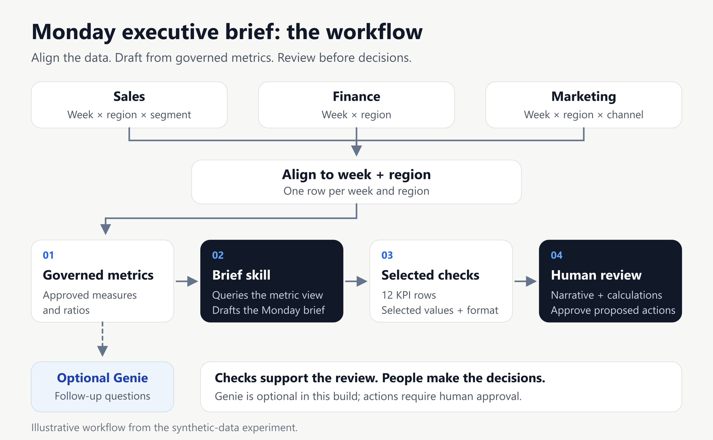
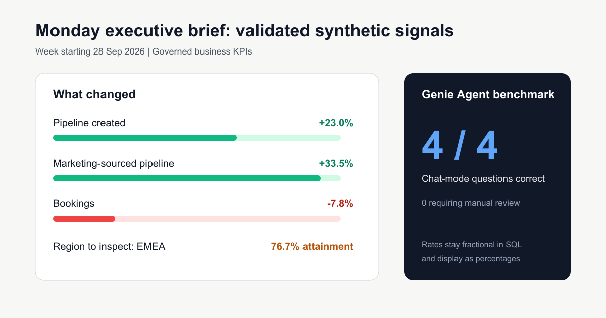

# Governed executive AI coworker

A runnable Databricks demo that combines sales, finance, and marketing metrics into a Monday decision brief—with proposed actions for people to review.

[Read the article](https://medium.com/@mkhomutskyi/executive-ai-pipeline-finance-marketing-decisions-b9d49313f2da) · [Set up the demo](docs/SETUP.md) · [View the sample brief](examples/monday-brief.md)



## What you can try

1. Load synthetic sales, finance, and marketing data.
2. Aggregate each source to one row per week and region before joining.
3. Define approved measures and ratios in a Unity Catalog metric view.
4. Draft a weekly brief with the reusable skill.
5. Check the KPI table and selected narrative values, then review the proposed decisions.

Genie is an optional branch for follow-up questions. The brief skill queries the metric view directly. No action is executed automatically.

## Try the local example

No Databricks account is needed for this preview. With Python 3.11 or later:

```bash
python scripts/preview_metrics.py
python skills/executive-monday-brief/scripts/check_brief.py examples/monday-brief.md examples/kpis.json
```

For a Databricks workspace, follow the [setup guide](docs/SETUP.md). It uses a sandbox schema and an existing SQL warehouse. Databricks Free Edition is suitable for non-commercial learning and is subject to quotas; customer deployments require an appropriate commercial workspace.

## The example result

The sample compares the synthetic weeks starting 21 and 28 September 2026:

| Signal | Result |
|---|---:|
| Pipeline Created | +23.0% |
| Bookings | −7.8% |
| Marketing-Sourced Pipeline | +33.5% |
| EMEA Bookings Attainment | 76.7% |



These fictional values illustrate the workflow. The four-question Chat benchmark tests those particular questions; it does not establish general accuracy or production readiness. The brief checker validates the 12-row KPI table, selected value markers, and the three-decision format. People still review meaning, calculated comparisons, and proposed actions.

## Project guide

| Folder | Purpose |
|---|---|
| `sql/` | Synthetic data, shared-grain view, example queries, and data checks |
| `metric-views/` | Stable, parameterized business metric definition |
| `genie-agent/` | Optional Agent configuration and creation helper |
| `skills/` | Brief template, workflow, and selected-value checker |
| `examples/` | Finished sample brief and its synthetic KPI inputs |
| `assets/` | Article diagrams and editable originals |
| `scripts/` | SQL runner and local KPI preview |
| `tests/` | Automated checks for the reusable demo |

## Development

```bash
uv sync --frozen --dev
uv run pytest -q
```

All business data is synthetic. Licensed under [Apache 2.0](LICENSE).
